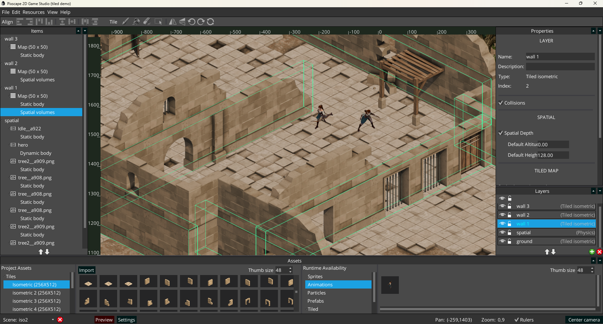

# Pixscape Tiled Iso Demo

This repository contains a small test project using **Pixscape Runtime**.

It demonstrates an isometric Tiled map with Pixscape’s **2.5D rendering features**, physics, animations, particles, prefabs, and simple combat gameplay.

## Controls

### Desktop / HTML

* **Arrow keys** — Move the hero
* **Space** — Attack

### Android

* **Swipe** — Move the hero
* **Double tap** — Attack

The project can run on:

* Desktop
* Android
* HTML

The project was generated with **LibGDX LiftOff**.

The Pixscape Studio project is located in the **studio** directory.

If you wish to modify the scene or add new scenes, use **Pixscape Studio Free**.

## Runtime performance checks

Run `gradlew lwjgl3:runtimeSpawnPerformance` for an opt-in desktop measurement using
the exported scene and assets. The report separates spawn calls from the peak of
the next three ECS/physics/render frames and records render-thread allocations.
It records the removal/synchronization frame separately as well.
It includes the first spawn, repeated spawns, bursts of 16, a populated scene,
an eight-member definition derived temporarily from the exported snake, and
particles with/without the ambient-lighting setter. Its temporary definition is
removed after the check. No timing threshold is used as a test assertion.

For HTML, build with `gradlew html:dist`, serve `html/build/dist` locally and open
`index.html?runtimeProbe=1`. The opt-in probe shows call timings, peaks of the next
four rendered frames and browser frame gaps. Browser heap deltas are trends,
not allocated-byte measurements. Normal launches still run the game.
Compare the same scene, viewport and build settings, with no other benchmark or
compiler running. Use p95/max and allocation evidence rather than average FPS.

## Links

* Pixscape website: https://pixscape.games/
* Pixscape Studio releases: https://github.com/pixscapegames/pixscape-studio-releases
* Pixscape Runtime: https://github.com/pixscapegames/pixscape-runtime
